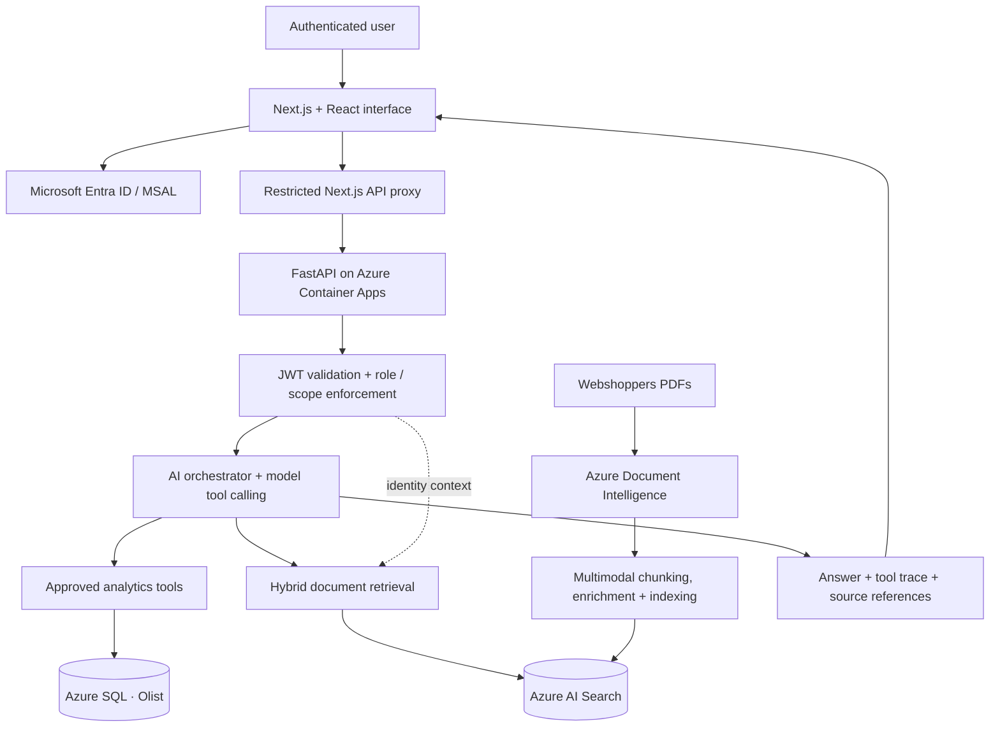

<div align="center">

# NEXORA

### Azure Enterprise AI Copilot

**Conversational analytics · Multimodal RAG · Secure agent orchestration**

A deployed Azure-based AI application that connects **structured e-commerce data** with **document evidence** through a single authenticated conversational interface.

**[View the visual project portfolio (PDF)](docs/portfolio/NEXORA_Portfolio.pdf)** · [Architecture](#system-architecture) · [Demonstrated workflows](#demonstrated-workflows) · [Engineering highlights](#engineering-highlights)

</div>

---

## The problem

Business questions rarely live in one system. Transactional data can explain **what happened**, while industry reports help explain **how those results compare with a broader market**. Investigating both often requires separate SQL queries, document searches, and manual synthesis.

**NEXORA** brings these sources into one workflow: users ask a question, the AI orchestrator selects approved tools, and the application returns a response grounded in SQL results, retrieved document evidence, or both.

> **Project scope:** An engineering portfolio implementation using historical Brazilian e-commerce data from Olist and Webshoppers industry research—not a commercial product or a claim of certified production readiness.

## At a glance

| Capability | Implementation |
|---|---|
| **Natural-language analytics** | Model-selected, predefined Python tools execute parameterized Azure SQL queries over historical Olist data. |
| **Document question answering** | Webshoppers PDFs are processed for text, tables, and figures, then indexed for retrieval-augmented generation. |
| **Cross-source investigation** | The orchestrator can call SQL and document-search tools within the same request. |
| **Evidence and traceability** | Responses expose supporting source references and tool execution details; source presence does not guarantee every interpretation is correct. |
| **Enterprise access controls** | Microsoft Entra authentication, API role/scope checks, and tenant/user/group document filtering. |
| **Azure deployment** | Next.js frontend, FastAPI backend, Azure Container Apps, container images, Bicep, and GitHub Actions. |

## See NEXORA in action

**[Open the 11-slide NEXORA portfolio and application demonstrations (PDF)](docs/portfolio/NEXORA_Portfolio.pdf)**

The portfolio contains actual application screenshots and a visual explanation of the architecture, technology stack, and engineering work.

### Demonstrated workflows

| Scenario | What the demonstration shows |
|---|---|
| **01 · SQL-backed analytics** | Asked for 2017 top product categories. NEXORA called `get_top_product_categories` and returned Azure SQL figures, including `bed_bath_table` at **BRL 490,596.92**. |
| **02 · Document-grounded research** | Asked about Brazilian e-commerce trends. NEXORA used `search_enterprise_documents` to retrieve Webshoppers 38 evidence with report references. |
| **03 · Combined investigation** | Compared historical Olist category performance with industry findings using both analytics and document evidence. |
| **04 · Evidence boundary** | Asked about an annual-leave policy absent from the indexed documents. NEXORA did **not** invent a policy answer. |

These are observed demonstrations, not a statistical benchmark of model accuracy.

## System architecture



**Important architectural boundaries:** The frontend proxy restricts which API routes it forwards; the FastAPI backend performs authorization checks. Document retrieval applies tenant and principal access filters. SQL analytics uses registered functions, not unrestricted model-generated SQL.

## Technology stack

| Area | Technologies used |
|---|---|
| **Frontend** | Next.js, React, TypeScript, MSAL, Tailwind CSS |
| **Backend** | Python, FastAPI, Pydantic |
| **AI orchestration** | Microsoft Foundry / Azure OpenAI model integration, Responses API function calling |
| **Data analytics** | Azure SQL Database, pyodbc, Microsoft Entra / Azure Identity |
| **Multimodal RAG** | Azure Document Intelligence, Azure AI Search, PDF text/table/figure processing, embeddings, hybrid retrieval |
| **Security** | Microsoft Entra ID, JWT verification, role/scope checks, managed identities, document ACL filtering |
| **Infrastructure and delivery** | Docker, Azure Container Registry, Azure Container Apps, Azure Bicep, GitHub Actions |
| **Testing** | pytest, API and orchestrator tests, retrieval and citation-focused tests |

## Engineering highlights

### 1. Controlled analytics over real relational data

NEXORA uses the **Brazilian E-Commerce Public Dataset by Olist**, loaded into eight Azure SQL tables covering orders, items, customers, products, sellers, payments, reviews, and category translations. The original dataset inventory recorded **550,759 rows** across those tables. Analytics tools execute defined SQL queries and return structured results to the model.

For the historical quarterly-sales metric, delivered-order item value is calculated from order-item prices, excluding freight. It should not be confused with gross merchandise value or total payment volume.

### 2. Multimodal document ingestion

The document pipeline processes Webshoppers reports using Azure Document Intelligence, including paragraphs, tables, and figures. Development work included **checkpoint-based resumable indexing** and **selective enrichment of 115 figure chunks** in a documented indexing run. These figures describe a specific engineering run, not a claim about every indexed document.

### 3. Retrieval grounded in identity and source evidence

Azure AI Search combines keyword and vector retrieval. Document access filtering incorporates tenant and user/group permissions. The application records tool calls and surfaces retrieved references, while citation relevance remains an evaluation concern rather than an assumed guarantee.

### 4. Full-stack Azure delivery

The deployed solution includes a Next.js interface, a restricted server-side API proxy, and a FastAPI service running in Azure Container Apps. Microsoft Entra is used for authentication and access enforcement; managed identity is used for supported Azure service connections. The repository contains Bicep infrastructure definitions and GitHub Actions workflows.

### 5. Debugging real integration failures

During live testing, Azure SQL intermittently returned error **40613** (database temporarily unavailable) and caused HTTP 500 responses. The incident was traced to SQL connectivity; the database is configured as serverless with a 60-minute auto-pause delay. A durable retry fix should be verified in deployed code before it is claimed as completed.

## Repository guide

```text
app/                 FastAPI routes, auth and model integration
agents/              Orchestration and registered analytics tools
rag/                 Document ingestion, indexing and retrieval
data/                Azure SQL access, schema and data pipelines
frontend/            Next.js application and API proxy
infrastructure/      Azure Bicep definitions
tests/               Backend, security, RAG and orchestration tests
.github/workflows/   Continuous integration and deployment workflows
docs/portfolio/      Recruiter-facing NEXORA portfolio PDF
```

## Running the project

The repository includes application code and deployment definitions, but a live end-to-end environment requires **your own Azure resources, Microsoft Entra configuration, model deployment, Azure SQL permissions, and search/index configuration**. Do not commit secrets or local `.env` files.

**Backend — development commands:**

```bash
python -m venv .venv
source .venv/bin/activate
pip install -r requirements.txt
python -m pytest -v
uvicorn app.main:app --reload
```

**Frontend — development commands:**

```bash
cd frontend
npm install
npm run dev
```

These commands install and start local components; they do not independently provision the Azure resources or configure authentication. Consult the source files and environment configuration for deployment-specific settings.

## Scope and next improvements

The portfolio demonstrates SQL analytics, multimodal document retrieval, combined reasoning, authenticated access, and cloud delivery. **Human-approved action execution** is part of the broader project vision and is **not presented here as a completed feature**. Additional work includes verifying robust transient SQL retry behavior and continuing citation-quality evaluation.

---

<div align="center">

**NEXORA · Azure Enterprise AI Copilot**

[Explore the visual portfolio](docs/portfolio/NEXORA_Portfolio.pdf)

</div>
